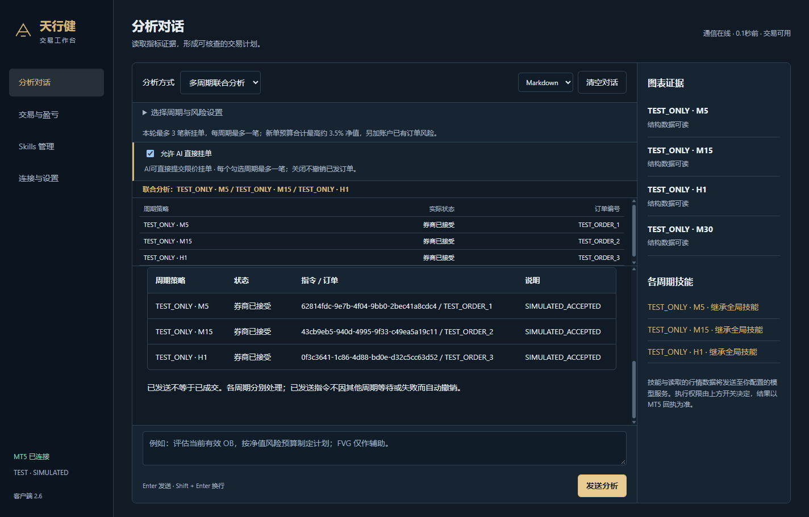

# 多周期分析与分别挂单指南

适用：客户端 **2.6.0**、通信 EA **2.50**。初次使用先完成[安装说明](安装使用说明.md)。

## 1. 先选对使用方式

| 你的目标 | 客户端分析方式 | 哪些周期允许新挂单 |
| --- | --- | --- |
| M5、M15、H1 各自找机会，符合条件的分别挂单 | 多周期联合分析 | 仅本轮勾选的周期，每周期最多一笔 |
| 用 H1/M15 看背景，只做 M5 入场 | 单周期策略，分析图表选 M5 | 只有 M5；其他周期只能辅助读取 |
| 看多个周期，但这轮不下单 | 多周期联合分析，关闭 AI 开关或明确要求仅分析 | 无 |
| 不同周期用不同技能或风险 | 先配置各单周期策略，再进入联合分析 | 联合模式按各周期配置执行 |

“联合分析”是一轮对话里读取多个周期、分别判断、逐笔提交并汇总结果。它不是所有订单在券商端原子同时成交，也不要求所有周期必须同时满足条件或方向一致。

## 2. MT5 需要怎样摆放

以 XAUUSD 的 M5、M15、H1 为例：

```text
同一个 MT5 终端
├─ XAUUSD M5   → 一份已有的兼容 SMC 指标
├─ XAUUSD M15  → 一份已有的兼容 SMC 指标
└─ XAUUSD H1   → 一份已有的兼容 SMC 指标

TianXingBridge 通信 EA → 只挂一张图表，读取上述所有周期
```

1. 每个周期单独打开图表，分别挂天行健 SMC 纯指标 1.02 并开启 `InpExportAIData`。
2. 通信 EA 保留一个，通信名称与客户端一致；多个周期共用它。
3. 客户端“图表证据”应分别出现 M5、M15、H1，显示结构数据可读。
4. 某周期缺失时先补齐图表和指标，不要靠提示词要求 AI 编造那一周期的价格或 OB。

数据必须来自各图表真实输出。某个快照里的高周期趋势摘要不等于另一周期完整的 OB/FVG 数据。各周期快照独立刷新，提交时还会检查最新快照、报价与账户状态。

## 3. 为不同周期配置技能

在“单周期策略”模式依次操作：

1. 选择 M5 图表。
2. 若继承 Skills 页面全局启用项，保持“单独选择技能”不勾选。
3. 若要专用组合，在右侧勾选“单独选择技能”，选择需要的技能。
4. 设置 M5 的单笔风险比例。
5. 切换 M15、H1，分别设置。

这些设置独立保存。示例只是配置演示，不代表推荐的市场方向或策略：

| 周期 | 可配置的技能用途 | 单笔预算示例 |
| --- | --- | --- |
| M5 | 观察短周期有效 OB、回踩和近端目标 | 净值 1% |
| M15 | 观察该周期的独立结构、OB 与目标 | 净值 1.5% |
| H1 | 观察小时结构和更远目标 | 净值 1% |

客户端只能读取你实际启用或为该周期选中的本地技能，不会自动导入 Codex 或其他项目的全部 Skills。联合模式里的技能说明会显示“继承全局”或该周期的专用选择。

## 4. 一次联合分析并分别挂单

### 步骤 1：进入联合模式

分析页将“分析方式”切换为 **多周期联合分析**，展开 **选择周期与风险设置**。

### 步骤 2：明确勾选目标

勾选 M5、M15、H1。一次可选 1–8 个图表。同品种同周期若打开了两张图，只选一个，避免重复策略；未勾选的图表不能在本轮被 AI 下单。

勾选、修改设置和切换周期本身都不会发单。需要改变勾选时先结束当前分析。“清空勾选”可以移除已关闭图表留下的旧选择。

### 步骤 3：核对各周期风险及合计

每个卡片可以设置自己的 1%–2% 单笔风险。输入后离开输入框，确认界面合计已更新。

以下仅为资金计算示例：若净值为 10,000、M5 为 1%、M15 为 1.5%、H1 为 1%，对应新单预算约为 100、150、100，合计 350，即净值 3.5%。最小手数和步长可能使实际估算金额更低；费用、滑点、跳空另计。

界面的合计是**本轮新单预算合计**，不是“所有周期共用一个 1%”，也不包含账户已有订单的风险。同账户中的多个周期会叠加风险。

### 步骤 4：选择执行方式

- 只看分析：关闭“允许 AI 直接挂单”，或本轮明确写“仅分析，不下单”。
- 允许 AI 提交：EA 的 `InpAllowTrading=true`，MT5 和该 EA 的算法交易及账户权限有效，再开启客户端开关。

如果提示账户或通信目录改变，先核对目标，再关闭并重新开启开关。开关开启并不启动无人值守循环，仍需要发送本轮分析请求。

### 步骤 5：发送一次请求

可直接复制：

```text
分别读取本轮勾选的 M5、M15、H1 真实指标快照。
按各周期自己的技能和风险预算，独立评估仍有效的 OB、合理结构外止损及真实目标，FVG 只作辅助。
符合条件的周期各提交一笔限价挂单，每个周期最多一笔；不满足条件的周期单独等待，不强行凑单。
未勾选周期不得下单，不自动撤改账户已有订单。
最后逐周期列出：结构判断、OB 区间、入场/SL/TP、RR、风险比例、执行或等待原因，以及实际指令和订单编号。
```

提示词中的周期要与实际勾选一致。例如只勾 M5、M15，就删去 H1 或改写为“本轮所有已勾选周期”。执行范围以界面的本轮勾选为准。

### 步骤 6：查看分周期结果

一次分析可能得到：

| 周期 | 结果示例 | 解释 |
| --- | --- | --- |
| M5 | 券商已接受 | 已提交该周期挂单，查看订单编号及 MT5 当前挂单 |
| M15 | 等待 | 没有合理目标或其他必要条件不足，本周期不提交 |
| H1 | 已拒绝 | 已尝试但预检或券商拒绝，查看真实原因和返回码 |

三个周期不会因一次点击就保证各出一单。有效 OB 是核心，FVG、Sweep/MSS、指标评分不是机械硬门槛；失效 OB、无法验证的价格、结构内止损、RR 小于 1、预算不足或权限/时效问题仍可阻止提交。



上图全部为隔离测试的 **TEST_ONLY / SIMULATED** 数据，仅用于说明界面位置，不是当前行情或真实订单。

## 5. 只让 M5 下单，H1/M15 只作过滤

这与“三个周期各自挂单”不同。做法如下：

1. 保留三张已挂指标的图表，确保都可读取。
2. 客户端切换到 **单周期策略**，执行图表选 **M5**。
3. 设置 M5 的风险比例和技能，按需要开启 AI 挂单开关。
4. 发送：

```text
执行周期只允许 M5。读取 H1、M15 的真实指标输出作为趋势、流动性和目标背景，再评估 M5 的有效 OB。
H1、M15 只用于辅助，不为它们生成或提交独立订单；本轮最多提交一笔 M5 限价单。
必要证据不足、止损不合理或 RR 小于 1 时等待，不编造缺失数据。
```

单周期执行校验会把挂单范围限制在 M5。不要为这个场景同时勾选 H1、M15 作为允许独立执行的联合目标。

## 6. 只分析，不自动挂单

在联合模式勾选周期后发送：

```text
仅分析，不下单。分别读取本轮勾选周期的真实结构，给出各周期可核查的 OB 计划或等待原因，并汇总周期之间的方向分歧。
```

如果价格计划成立，AI 可以按周期输出带 `chart_id` 的计划，分别出现“填入该周期交易表单”按钮。填入本身不会发送，仍需在交易页核对并完成原生确认。已自动提交的计划不应再次手工重复提交。

## 7. 挂单如何归属、聊天如何保存

- 新指令记录策略 ID、品种、周期、图表和本轮分析批次。EA 的订单备注附带周期及指令标记，客户端结合券商订单/成交标识追溯。
- “交易与盈亏”选择策略筛选，可查看对应周期记录；账号整体余额与浮盈仍是同一个账户的数据。
- 无可靠归属的旧单显示“其他 / 旧版订单”，不会按同品种猜测。
- 联合聊天按账户、通信目录、品种/周期组合保存。选回同一组周期可恢复；顺序改变不会新建另一份同组合聊天。
- 单周期聊天会增加该周期的联合执行摘要。重启或恢复聊天不会重新发单。

对冲账户可保留不同周期的多笔持仓。净额账户同品种可能合并，合并持仓不能简单按周期拆开关闭；客户端会在能追溯多个策略时标明“多策略合并持仓”。

## 8. 执行过程中遇到中断

| 情况 | 当前处理方式 |
| --- | --- |
| 某周期条件不满足 | 该周期单独等待，其他选中周期仍可评估 |
| 券商明确拒绝某笔 | 显示拒绝原因；该周期本轮不重复提交，可继续评估其他周期 |
| 某笔结果未确认 | 阻止继续发新的 AI 指令，先回查 MT5 |
| 分析中关闭开关或点击停止 | 尚未发送的订单被阻止；已有订单不会自动撤销 |
| 模型 API 在已发送一笔后报错 | 保留逐周期实际回执与中断说明，不把已发订单当成没发生 |
| 账户或 EA 会话改变 | 旧上下文禁止继续提交，需要核对并重新分析 |
| 客户端刷新或重启 | 恢复记录，不重发，不自动撤单 |

“券商已接受”始终不等于已成交。限价单可能仍在等待价格进入，先看订单编号、当前挂单和 MT5 实际回报，再决定人工撤改。当前没有定时循环分析、自动结构撤单或计划到期自动撤单。
